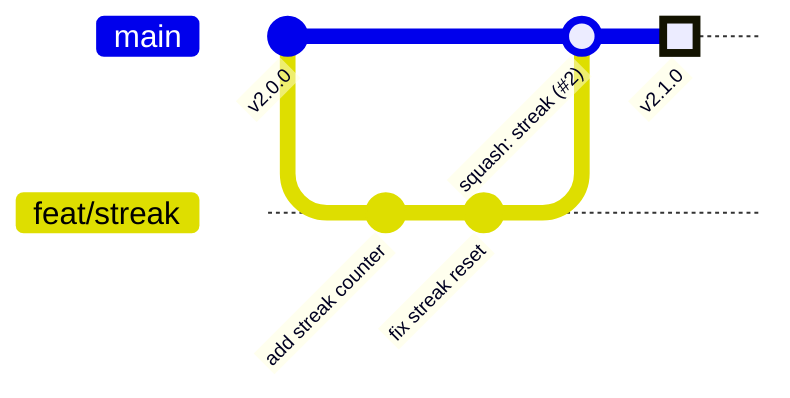
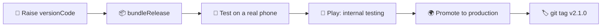

<div align="center">

# 🤝 Contributing

**How we change this app without breaking it.** Read this once and you know the whole flow.

</div>

<br>

## 🧠 The idea in one picture

`main` is the app people can download. Nobody edits it directly.
You work on a **copy (a branch)**, show it in a **pull request**, and it joins `main` only after it is checked.



> 🎮 **Think of a video game.** `main` is your saved game. A branch is a new save slot where you try something
> risky. If it works, you copy it back into your main save. If not, you delete the slot and nothing is lost.

<br>

## 🔁 The flow, step by step

| Step | Do this | Command |
|:--:|---|---|
| 1️⃣ | Start from the latest `main` | `git switch main && git pull` |
| 2️⃣ | Make your branch | `git switch -c feat/streak-counter` |
| 3️⃣ | Change code, then save a snapshot | `git add <files>` → `git commit -m "feat(home): add streak counter"` |
| 4️⃣ | Upload the branch | `git push -u origin feat/streak-counter` |
| 5️⃣ | Ask for review | `gh pr create --fill` |
| 6️⃣ | Wait for the ✅ from CI (about 4 min) | `gh pr checks --watch` |
| 7️⃣ | Merge and clean up | `gh pr merge --squash --delete-branch` |

<br>

## 🏷️ Naming

<table>
<tr><th>Branches</th><th>Commits</th></tr>
<tr><td>

```
feat/lesson-player
fix/crash-on-rotate
chore/bump-gradle
docs/release-guide
```

</td><td>

```
feat(lesson): play lessons offline
fix(auth): keep login after restart
chore(deps): update Gradle to 8.14.3
docs: explain the release steps
```

</td></tr>
</table>

| Type | Use it when |
|:--:|---|
| `feat` | something new a user can see |
| `fix` | a bug is gone |
| `chore` | build, tools, versions |
| `docs` | only text changed |
| `refactor` | code is cleaner, behaviour is the same |
| `test` | tests only |

✅ `fix(auth): keep login after restart` &nbsp;&nbsp; ❌ `fixed stuff` &nbsp;&nbsp; ❌ `Update MainActivity.kt`

<br>

## 🚀 Shipping to Google Play



- 🔢 **`versionCode` only goes up.** Play rejects a number it has seen before.
- 🏷️ **Version names** follow `MAJOR.MINOR.PATCH`: `2.1.0` adds a feature, `2.1.1` fixes a bug.
- 🏷️ **Tag the release** after it is live: `git tag v2.1.0 && git push origin v2.1.0`.

<br>

## 🔒 Never commit

| File | Why |
|---|---|
| `keystore.properties`, `*.jks` | The signing key. Lose it or leak it and the app can never be updated again |
| `google-services.json` | Firebase project keys |
| `local.properties` | Paths on your own laptop |
| `build/`, `.idea/` | Generated; everyone's is different |

`.gitignore` already blocks these. If `git status` ever lists one, **stop and ask**.

<br>

## 👥 Working as a team

- 💬 **Say it before you build it.** Open an issue for anything bigger than a day.
- ✂️ **Keep PRs small.** Under ~400 lines gets a real review. 3,000 lines gets a "looks fine".
- 👀 **Someone else reviews.** The author never merges unreviewed work into a release.
- 🔄 **Pull `main` often** (`git pull origin main`), so conflicts stay small.
- 🤖 **Claude follows the same rules.** It branches, commits and opens the PR. You review and merge.
