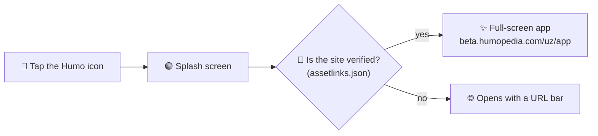

<div align="center">


# Humopedia

### Maths and science you play with your hands.

The Android app for **Humopedia**, the learning platform for kids aged 10 to 12 in Uzbekistan.

[](https://github.com/tolipovmurodjon/humopedia-android/actions/workflows/build.yml)


[**Website**](https://humopedia.com) &nbsp;·&nbsp; [**Brand**](https://design.humopedia.com) &nbsp;·&nbsp; [**Google Play**](https://play.google.com/store/apps/details?id=com.mcompany.humo) &nbsp;·&nbsp; [**Contributing**](CONTRIBUTING.md)

</div>

<br>

## ✨ What makes it different

| | |
|:--:|---|
| ⚖️ | **Every lesson is a toy.** Solve equations by balancing a scale. Prove Pythagoras by cutting squares. |
| 🎮 | **It feels like a game.** Streaks, XP, leagues, and a friend called Humo who cheers you on. |
| 🇺🇿 | **Made for Uzbekistan.** Uzbek first, built for cheap phones on slow networks. |

<br>

## 🧭 How it works

Version 2 shows the Humopedia web app full screen, with no browser bar. This setup is called a
**Trusted Web Activity**. The app and the website run the same code, so each website update reaches the app too,
with no new Play release.



<br>

## 🗺️ Roadmap

| | Version | What's inside |
|:--:|---|---|
| ✅ | **2.0.1** | The web app full screen: every lesson, quiz and game. **Live on Google Play** |
| 📋 | 3.x | Native Jetpack Compose screens, replacing the web app one screen at a time |

<br>

## 🚀 Quick start

> **You need:** Android Studio (latest) · JDK 17+ · an Android phone with USB debugging on

```bash
git clone git@github.com:tolipovmurodjon/humopedia-android.git
cd humopedia-android
./gradlew installDebug
```

That builds the app and installs it on your phone. 🎉

<details>
<summary><b>📦 Building a release for Google Play</b></summary>

<br>

**1 ·** Create `keystore.properties` in the project root. Git ignores it, so it is never committed.

```properties
storeFile=/path/to/humopedia_keystore.jks
storePassword=…
keyAlias=humopedia_key
keyPassword=…
```

**2 ·** Raise `versionCode` in `app/build.gradle.kts`. It must be higher than every version already on Play.

**3 ·** Build:

```bash
./gradlew bundleRelease
# → app/build/outputs/bundle/release/app-release.aab
```

**4 ·** Test it on a real phone, then send it to Google Play in one command (needs `serviceAccount-play.json`, the
Play API key, in the project root; git ignores it):

```bash
./gradlew publishBundle   # uploads to production and sends it for review, notes from app/src/main/play/release-notes/
```

</details>

<details>
<summary><b>🗂️ Where things live</b></summary>

<br>

```
app/src/main/AndroidManifest.xml     what the app opens, its icon, splash, links
app/src/main/res/values/strings.xml  the web address and the verified site
app/src/test/                        unit tests
gradle/libs.versions.toml            every library version, in one place
.github/workflows/build.yml          CI: tests and a build on every pull request
```

</details>

<br>

## 🧱 Built with

`Kotlin` · `Android Browser Helper (Trusted Web Activity)` · `Gradle Kotlin DSL` · `version catalog` · `GitHub Actions`

<br>

---

<div align="center">
<sub>Made in Tashkent by <b>HUMOPEDIA EDU MChJ</b> · © 2026 · All rights reserved</sub>
</div>
